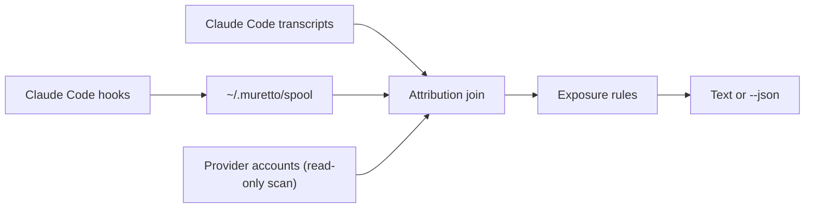

Muretto joins two sources: what your agent sessions did, and what really exists in your provider accounts. Each command reads both, joins them, and checks what is exposed.



## 1. Hooks record what the agent did

`muretto init` adds hooks to your Claude Code settings for these events: session start and end, each prompt, each tool call (successful or failed) and each subagent start.

On each event the hook writes one small file to `~/.muretto/spool` and exits. Before writing, it:

- redacts secrets such as tokens, keys and passwords;
- caps large tool output (head and tail are kept);
- for an MCP server pinned to one project, records that project's id from your MCP config, never its URL or headers.

The hook never touches the network, never prints anything and always lets the agent continue. Errors go to `~/.muretto/hook-errors.log`.

Muretto also reads your Claude Code transcripts. That finds sessions the hooks missed, such as ones from before you installed them.

## 2. Read-only scans list what exists

When you run a command, Muretto lists what is in your connected accounts. Every request goes through one module, the broker. The broker refuses any request that is not an allowlisted read, before anything is sent:

- only `GET` requests, plus one fixed, read-only Supabase catalog query if you turn on full table listing;
- only hosts, paths and query parameters the provider's adapter declares;
- secret fields are stripped from responses before the rest of Muretto sees them.

A scan is reused for 60 seconds. `--refresh` forces a new one. Output always says how old the data is ("checked 3 min ago").

## 3. The join assigns a label

Each resource gets one of two labels.

| Label | Means |
|---|---|
| `exact` | One session's own successful tool call created it. |
| `unknown` | Shown as **creator unknown**. The evidence is missing, or more than one session claims it. |

A session gets `exact` only through direct evidence in its tool call:

- the resource's provider id appears in the result of a creating call;
- the resource's own URL appears in that result, such as a deployment URL;
- the call names the resource in a specific project or team, the name matches exactly one resource there, the call succeeded, and no other session created something with that name.

Timing never creates a match. A provider's creation time can only rule a session out, for example when the resource is older than the call. A session that only read or mentioned a resource does not count as its creator.

If a session's output says it created something that no connected account lists, the resource is shown as `?` and **not confirmed**.

`muretto why` shows the evidence behind a label:

```text
$ muretto why customers
table customers: exact
Created by session 8f2a (alice) (rule name_in_container)
Reason: session 8f2a1c3e created it: a creating call named this table in its container, and no other session did

Evidence
  1. Oct 19 14:06 · session 8f2a (alice) · mcp__supabase__apply_migration
     matched projaaaaaaaaaaaaaaaa/public.customers (supabase.mcp.apply_migration, toolu_01FAKEaaaaaaaaaaaaaaaaa1)
```

## 4. Exposure rules flag what is open

Each provider adapter declares rules for what is open to anyone on the internet: a table anyone can read (RLS off), a public bucket, a public preview. Each result has one of three states:

| State | Means |
|---|---|
| `exposed` | The rule found the resource open to anyone. |
| `not_exposed` | The check ran successfully and found nothing open. |
| `unknown` | The check failed, a field was missing, or nothing was checked. |

A check that didn't run is never reported as `not_exposed`. `muretto exposed` lists every exposed finding, worst first, with the session that created it.

## Local files

Everything lives in `~/.muretto`, or in `MURETTO_HOME` if you set it. Directories are `0700` and files `0600`. Tokens are never written here: they stay in your OS keychain or your environment.

| Path | What it holds |
|---|---|
| `config.json` | Your display name, connected account ids and sync settings |
| `muretto.db` | The local SQLite store |
| `spool/` | One file per hook event, read on your next command |
| `hook-errors.log` | Hook errors (the hook itself never prints) |
| `backups/` | Copies of your Claude Code settings from before `init` changed them |
| `install-manifest.json` | Exactly what `init` added, so `uninstall` removes exactly that |

For what stays local and what can leave your machine, see [Privacy and security](/privacy).
